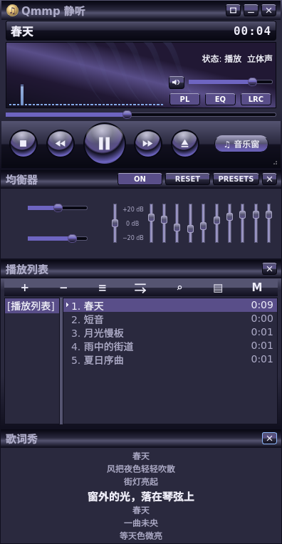

# Qmmp 经典中文播放器

基于 Qmmp 2.3.1 和 Qt 6 的本地音乐播放器。默认「紫晶」皮肤参考千千静听的四窗布局，从上到下依次是播放主机、均衡器、播放列表和同步歌词。原有 Skinned 和 QSUI 界面仍可在设置中选择。



## 编译与运行

需要 CMake 3.18 或更新版本、C++17 编译器和 Qt 6.2 或更新版本（含 Widgets、Network 和 LinguistTools）。Ubuntu/Debian 的编解码和构建依赖可用以下命令安装：

```sh
sudo apt install build-essential cmake pkg-config ffmpeg libtag1-dev libmpg123-dev \
    libavcodec-dev libavformat-dev libavutil-dev libasound2-dev libpulse-dev
```

使用独立安装的 Qt SDK 时，将 `QT_PATH` 指向含 `bin/qt-cmake` 的目录。脚本也支持 CMake 能直接找到的 Qt。

```sh
./build.sh
./run.sh
ctest --test-dir build-classic --output-on-failure
```

首次使用默认打开经典中文界面。已有配置会沿用之前选择的界面，可在设置的界面插件列表中选择「经典中文播放器」并重启。

## 经典界面

- 将歌曲拖入主机即可播放，拖入播放列表则加入队列。列表右侧显示每首歌的时长，长标题会自动省略，未知时长显示为「—」。
- 播放列表上方第四个按钮切换顺序播放和随机播放，保留曲目的显示顺序。第三个按钮用于排序或反转列表。
- 点击主机左侧的频谱，依次切换频谱柱、时域波形和左右声道电平。键盘聚焦到该区域后按回车也可切换。暂停、停止或最小化时，可视化停止刷新。
- 点击时间读数可切换已播放时间与剩余时间。静音时，音量键的喇叭上会出现斜杠。
- 点击主机右上角紧邻最小化键的迷你模式按钮，播放器会收成屏幕右上角的置顶横条。按住歌名或空白处即可拖动，右侧按钮可切歌、暂停，或还原之前的窗口布局。[迷你模式截图](doc/classic-mini.png)
- 顶部状态栏的播放器菜单显示当前曲目，点击曲名可打开播放器。菜单内可以暂停或继续、切歌、停止和静音。
- 空格切换播放和暂停。主机上的 **PL**、**EQ** 和 **LRC** 分别显示或隐藏播放列表、均衡器和歌词。拖动标题栏可分离或吸附各窗；点击主机左上角音符，从「视图 → 磁吸排列」恢复纵向布局。
- 均衡器提供前级增益和十段频率调节。点 **OFF/ON** 切换处理状态，点 **PRESETS** 应用预设，点 **RESET** 将增益归零。
- 点击左上角音符，在「皮肤」菜单中切换「紫晶」、「海蓝」或[「曜石黑」](doc/classic-obsidian.png)，或通过「载入皮肤…」选择自定义 INI。四个窗口会一起换肤，重启后保留选择。

「音乐窗」用于搜索当前列表，支持将结果加入队列或直接跳转播放。音乐窗和设置也使用所选皮肤。[音乐窗截图](doc/classic-music.png) · [设置截图](doc/classic-settings.png)

自定义皮肤可复制 [紫晶配色清单](src/plugins/Ui/classic/skins/violet.ini)，修改名称及颜色。在 `[Skin]` 中添加 `Style=custom.qss` 可叠加同目录的 Qt 样式表。控件选择器见[内置样式表](src/plugins/Ui/classic/skins/classic.qss)，样式表内可用 `url("@SKIN_DIR@/button.png")` 引用图片。请保留清单和素材的位置，播放器会在启动时从该位置重新加载。经典界面尚不支持直接导入原版千千静听的皮肤包。

## 歌词与解码器

把歌词和歌曲放在同一目录，例如 `春天.flac` 与 `春天.lrc`。支持 UTF-8、GB18030、每行多个时间戳以及 `[offset:毫秒]`。拖动进度或切换歌曲会重新定位歌词。

MPEG 和 FFmpeg 插件提供 MP3、M4A、FLAC、Ogg Vorbis 和 PCM WAV 支持。也可安装专用解码器。Linux 用户可以把与当前 Qt、Qmmp ABI 兼容的解码器放入 `${XDG_CONFIG_HOME:-$HOME/.config}/qmmp/plugins-2.3/Input/`，重启后加载。开发接口见 `src/qmmp/decoderfactory.h` 和 `src/qmmp/decoder.h`。扩展模块编译示例见 `src/plugins/Input/flac/`。

## 打包

`package_deb.sh` 面向 Linux Qt SDK。需要 `dpkg-dev`、`patchelf`、Qt SQLite 和 XCB 平台插件。脚本从同一次构建生成安装包，随包携带私有 Qt 运行库，用 Debian 工具识别系统依赖。

```sh
sudo apt install dpkg-dev patchelf
./package_deb.sh
sudo apt install ./build-classic/dist/qmmp_2.3.1-1_amd64.deb
```

在目标发行版上构建对应架构的包。amd64 文件名如上，其他架构由 `dpkg --print-architecture` 确定。
